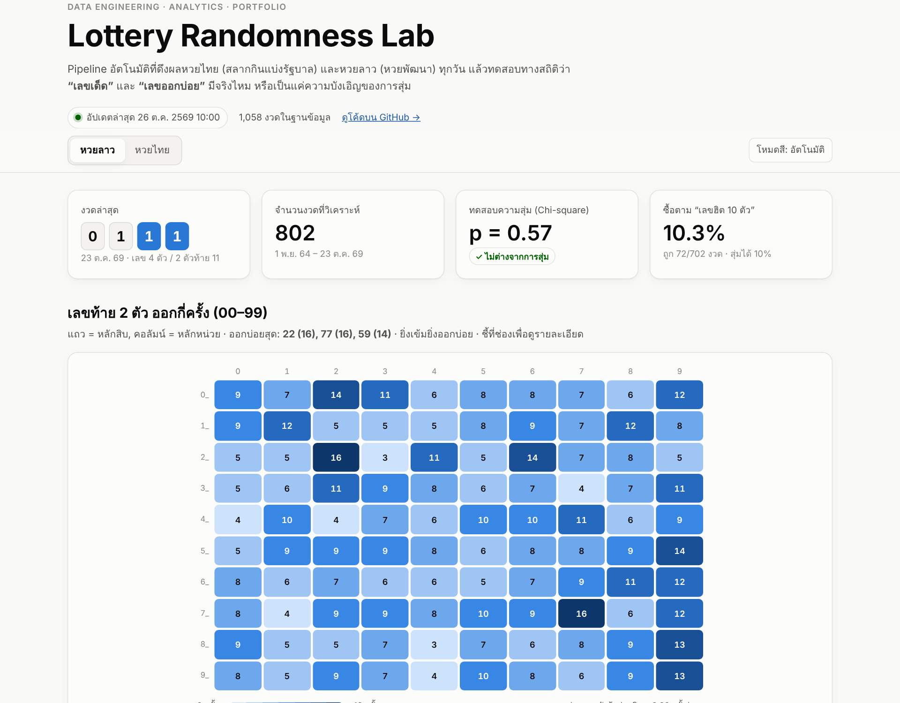

# Lottery Randomness Lab

**Live dashboard:** https://shelbyboss.github.io/lotto-pipeline/

[](https://shelbyboss.github.io/lotto-pipeline/)

An end-to-end data project. It pulls Thai Government Lottery and Lao Development Lottery results **every day**, validates and stores them, runs statistical tests, and publishes an interactive dashboard. Everything runs on GitHub's free tier. No server, and no laptop left switched on.

> The question: are "hot numbers" (เลขเด็ด / เลขออกบ่อย) real, or just randomness?
> The answer, from 1,000+ draws: they are randomness. See the dashboard for the numbers.

  

## Architecture

```
 ┌──────────────┐   ┌──────────────┐   ┌───────────────────┐   ┌──────────────┐
 │  Extract     │──▶│  Validate    │──▶│  Load + Analyze   │──▶│  Serve       │
 │ GLO JSON API │   │ regex checks │   │ atomic CSV write  │   │ GitHub Pages │
 │ Sanook HTML  │   │ dedupe, typo │   │ chi-square, binom │   │ static HTML  │
 │ retry/backoff│   │ unit tests   │   │ walk-fwd backtest │   │ + SVG charts │
 └──────────────┘   └──────────────┘   └───────────────────┘   └──────────────┘
          ▲                                                            │
          └──────── GitHub Actions cron (22:10 + 07:10 Bangkok) ───────┘
```

| Layer | What it does | File |
|---|---|---|
| Extract | Thai results come from the official **GLO API** (`glo.or.th`). Lao results are parsed from per-draw pages. Uses HTTP retry with exponential backoff. | `pipeline/sources.py` |
| Validate | Checks number format. When the source's 2-digit and 4-digit Lao numbers disagree (a known source typo), the 4-digit result wins. Unit tests run before every update. | `pipeline/sources.py`, `tests/` |
| Load | Incremental: re-checks the last 3 days so late-published results are caught. Idempotent dedupe on `draw_date`. Writes go to a temp file and are swapped in atomically. | `pipeline/update.py` |
| Analyze | Chi-square goodness-of-fit (2-digit, tens, units), walk-forward "hot-10" backtest with a binomial test, gap since last seen, and a monthly breakdown. | `pipeline/stats.py` |
| Forecast | Four simple models (seasonal, hot, recency-weighted, overdue) each pick 10 numbers at the start of every month, using only earlier data. A monthly walk-forward scorecard compares each one against the 10% random baseline. | `pipeline/stats.py` |
| Serve | A single static page reads `docs/data/*.json, *.csv`. It has light/dark mode and tooltips, and works on mobile. | `docs/index.html` |
| Orchestrate | Daily cron, a manual backfill input, a concurrency guard, and a commit only when data changed. | `.github/workflows/update.yml` |

## Key findings (auto-updated on the dashboard)

| | Thai (2016–now) | Lao (Nov 2021–now) |
|---|---|---|
| Draws | 256+ | 800+ |
| Chi-square, 100 numbers | p ≈ 0.34 → random | p ≈ 0.57 → random |
| Buy the 10 "hottest" numbers each draw | 9.5% hit rate (random = 10%) | 10.3% hit rate (random = 10%) |
| Expected return, 2-digit prize | 25% (2-digit prize only) | 60% |

## Run locally

```bash
pip install -r requirements.txt
python -m pytest -q                       # parser tests
python -m pipeline.update                 # incremental update
python -m pipeline.update --since 2021-11-01   # backfill / re-check a range
python -m http.server -d docs 8000        # open http://localhost:8000
```

## Data

- `docs/data/thai.csv` has `draw_date, first_prize, last2, front3, back3`.
- `docs/data/lao.csv` has `draw_date, last4, last2`.
- `docs/data/stats.json` holds the precomputed metrics the dashboard reads.
- `docs/data/meta.json` is the run log: last run time, rows added, and errors.

Sources: Government Lottery Office (glo.or.th), and Sanook for Lao results. This is an educational data and statistics project. It is not gambling advice.
